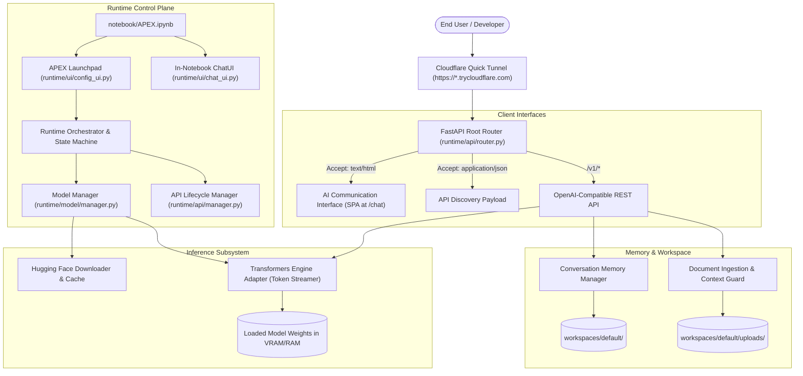

# APEX Architecture Overview

APEX is an open-source, notebook-first cloud AI runtime platform designed to run machine learning models using Google Colab or local compute resources and expose them through an accessible web interface and an OpenAI-compatible REST API.

---

## 1. High-Level System Architecture



---

## 2. Core Subsystems

### A. Control Plane & Notebook First
The master control plane is [`notebook/APEX.ipynb`](file:///D:/APEX/notebook/APEX.ipynb). Users configure hardware parameters and select models using the interactive Launchpad (`ConfigUI`). The Launchpad drives a non-blocking background deployment pipeline that coordinates validation, downloading, weight allocation, warmup inference verification, and tunnel startup.

### B. Model Engine & Management
- **ModelManager** ([`runtime/model/manager.py`](file:///D:/APEX/runtime/model/manager.py)): Enforces clean Hugging Face repository identifiers (`org/model-name`). Manages downloading, cache verification, and engine binding.
- **Inference Adapter** ([`runtime/engine/transformers_adapter.py`](file:///D:/APEX/runtime/engine/transformers_adapter.py)): Uses Hugging Face `AutoModelForCausalLM` with `TextIteratorStreamer`. Generates non-blocking token streams in background threads with ChatML formatting and automatic EOS/PAD token mapping.
- **Warmup Verification**: Before declaring a model ready, APEX performs an actual warmup generation (`Hello -> 5 tokens`) to verify that model weights and tokenizers operate without error.

### C. API Server & Networking
- **FastAPI / Uvicorn** ([`runtime/api/server.py`](file:///D:/APEX/runtime/api/server.py)): Serves both OpenAI-compatible JSON REST endpoints and the single-page HTML Web Chat.
- **Cloudflare Quick Tunnel** ([`runtime/api/tunnel.py`](file:///D:/APEX/runtime/api/tunnel.py)): Connects local port 8000 to Cloudflare's edge network, obtaining a public `https://*.trycloudflare.com` URL with zero port-forwarding or account requirements.
- **Transparent DoH Fallback**: Queries Cloudflare 1.1.1.1 via DNS-over-HTTPS to resolve brand-new Quick Tunnel domains without waiting for local ISP DNS propagation delays.

### D. AI Communication & Ingestion
- **Single-Page Application** ([`runtime/api/web_interface.py`](file:///D:/APEX/runtime/api/web_interface.py)): Responsive dark-mode interface featuring live token streaming, conversation sidebar, attachment tags, markdown rendering, syntax-highlighted code blocks, and developer integration drawer.
- **Document Processor** ([`runtime/api/file_processor.py`](file:///D:/APEX/runtime/api/file_processor.py)): Extracts text safely from `.txt`, `.py`, `.json`, `.csv`, `.docx`, and `.pdf` files. Caps extracted context at 16,000 characters to prevent context window overflow.
- **Conversation Memory** ([`runtime/memory/conversation.py`](file:///D:/APEX/runtime/memory/conversation.py)): Retains conversational turns in JSON files per workspace, with a sliding window guard retaining the system instruction and the 16 most recent turns.

---

## 3. Runtime State Machine

APEX enforces strict runtime states:

```text
UNINITIALIZED
     │
     ▼
VALIDATING ─────────────► FAILED
     │
     ▼
MODEL_DOWNLOADING ──────► FAILED
     │
     ▼
MODEL_LOADING ──────────► FAILED
     │
     ▼
MODEL_READY
     │
     ▼
API_STARTING ───────────► FAILED
     │
     ▼
READY (Verified Public Inference)
```

APEX **never** reports `READY` simply because a process has spawned; the endpoint must return a verified HTTP 200 on `/health` and complete an actual end-to-end inference probe.

